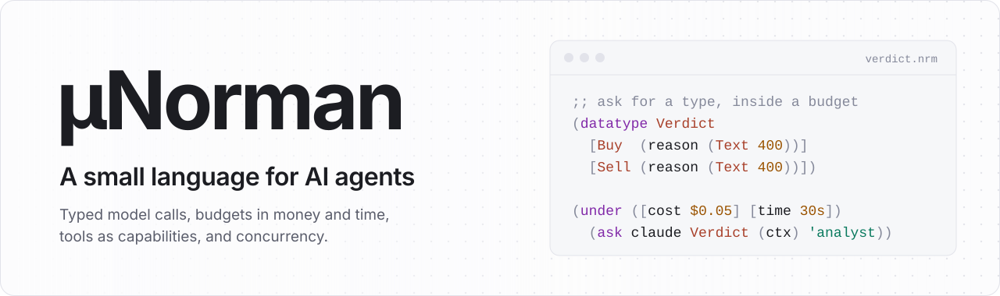
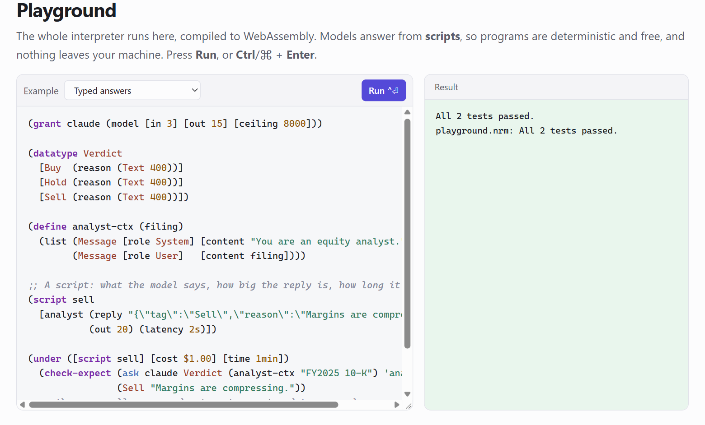
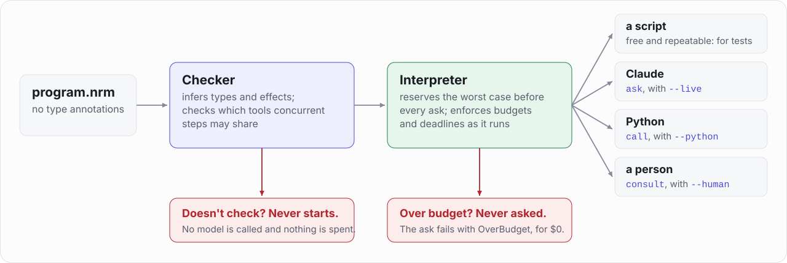

<p align="center">
  <a href="https://norman-docs.vercel.app/">
    <picture>
      <source media="(prefers-color-scheme: dark)" srcset="assets/banner-dark.svg">
      
    </picture>
  </a>
</p>

<p align="center">
  <a href="https://github.com/iliketocode2/Norman/releases/latest"></a>
  <a href="https://github.com/iliketocode2/Norman/actions/workflows/docs.yml"></a>
  <a href="https://norman-docs.vercel.app/playground"></a>
  <a href="#license"></a>
  
</p>

<p align="center">
  <a href="https://norman-docs.vercel.app/"><b>Website</b></a> ·
  <a href="https://norman-docs.vercel.app/docs"><b>Docs</b></a> ·
  <a href="https://norman-docs.vercel.app/playground"><b>Playground</b></a> ·
  <a href="https://norman-docs.vercel.app/demo"><b>Demo</b></a> ·
  <a href="design/README.md"><b>Design</b></a> ·
  <a href="eval/"><b>Eval</b></a>
</p>

---

**µNorman** is a small programming language for AI agents. Every call to a
model names the **type** of answer it wants, every run has a **budget** in
money and time that's never overspent, and tools are **capabilities** a model
can never create. It's designed in the style of Norman Ramsey's *Programming
Languages: Build, Prove, and Compare*, and implemented as a definitional
interpreter in Rust.

> [!NOTE]
> **Research prototype.** The language and interpreter work, and the whole
> design is written down in [`design/`](design/README.md), but nothing has
> been benchmarked against a hand-written agent.

## Contents

- [Why µNorman](#why-µnorman)
- [A taste](#a-taste)
- [Try it](#try-it)
- [How a program runs](#how-a-program-runs)
- [Running against a real model](#running-against-a-real-model)
- [Can a model write it?](#can-a-model-write-it)
- [Repository map](#repository-map)
- [License](#license) · [Bibliography](#bibliography)

## Why µNorman

The papers this design draws on (see the [bibliography](#bibliography)) keep
finding the same problems with agents. Each has a direct answer in the
language:

| Problem | What µNorman does |
|---|---|
| Unreliable answers | every `ask` names the **type** of answer it wants |
| Decisions | answers can be **choices** that the program branches on |
| Cost and deadlines | **money and time** are built in, and the budget is never overspent |
| Latency | each budget has one **shared clock** with deadlines |
| Failed steps | **failures are values**, and `retry` wraps a single step |
| Tool access | tools are **capabilities** that a model can never create |

Types, and which tools concurrent steps may share, are checked before a
program runs. Budgets and deadlines are enforced while it runs.

## A taste

Ask a model for a `Verdict`. If the reply fits the type, you get a real value
back; if it doesn't, the ask fails with `Invalid`, and you can catch it.
Before calling the model, `ask` reserves the worst case, the full prompt plus
the longest answer the type allows, so a call that might not fit the budget is
never made.

```scheme
(grant claude (model [in 3] [out 15] [ceiling 8000]))

(datatype Verdict
  [Buy  (reason (Text 400))]
  [Hold (reason (Text 400))]
  [Sell (reason (Text 400))])

(define analyst-ctx (filing)
  (list (Message [role System] [content "You are an equity analyst."])
        (Message [role User]   [content filing])))

;; A script: what the model says, how big the reply is, how long it takes.
(script sell
  [analyst (reply "{\"tag\":\"Sell\",\"reason\":\"Margins are compressing.\"}")
           (out 20) (latency 2s)])

(under ([script sell] [cost $1.00] [time 1min])
  (check-expect (ask claude Verdict (analyst-ctx "FY2025 10-K") 'analyst)
                (Sell "Margins are compressing."))
  ;; the same call, measured: at most a cent and two seconds
  (check-within (ask claude Verdict (analyst-ctx "FY2025 10-K") 'analyst)
                ([cost $0.01] [time 2s])))
```

**A mistake costs nothing.** Types and effects are inferred, with no
annotations, and a program that doesn't check never starts. Use the answer as
if it were text:

```scheme
(grant claude (model [in 3] [out 15] [ceiling 8000]))

(datatype Verdict
  [Buy  (reason (Text 400))]
  [Sell (reason (Text 400))])

(define headline (filing)
  (string-append "Analyst says: "
    (ask claude Verdict (list (Message [role User] [content filing])) 'analyst)))
```

and no model is called:

```console
$ cargo run -q -- headline.nrm
type error: headline.nrm:8:3: in the definition of headline: in an argument of string-append: expected Text, but found Verdict
The program was not run, because it doesn't type-check.
```

Each diagnostic names the line and column of the expression at fault. For
tools that repair programs, `--format json` writes each one as a JSON object,
with the two types of a mismatch as separate fields, and `--explain` adds the
design document that gives each rule's reason. `--no-check` runs a program
without the checker.

## Try it

**In your browser.** The whole interpreter runs in the
[playground](https://norman-docs.vercel.app/playground), compiled to
WebAssembly. Models answer from scripts, so it's free and nothing leaves your
machine.

<p align="center">
  <a href="https://norman-docs.vercel.app/playground">
    <picture>
      <source media="(prefers-color-scheme: dark)" srcset="assets/playground-dark.png">
      
    </picture>
  </a>
</p>

**On your machine.** You need a Rust toolchain. No API key is needed for
either command:

```bash
git clone https://github.com/iliketocode2/Norman.git && cd Norman
cargo run -- examples/step5-examples.nrm    # load a program and run its unit tests
cargo test                                  # the design's example results and laws
```

Then read the guide, [design/README.md](design/README.md), or the
[language reference](https://norman-docs.vercel.app/docs). To hand the
reference to an agent as context, use the **.md** button on the website, or
[`docs/munorman-reference.md`](docs/munorman-reference.md).

## How a program runs

<p align="center">
  <picture>
    <source media="(prefers-color-scheme: dark)" srcset="assets/how-it-runs-dark.svg">
    
  </picture>
</p>

The same program runs against a script in tests and against a real model in
production; only the flags change. Failures are values, in seven kinds:
`Invalid`, `ToolError`, `Refused`, `Declined` (a person said no),
`OverBudget`, `PastDeadline` and `Raised`.

## Running against a real model

```bash
cargo run -- --live --trace examples/cp-agent.nrm                     # asks go to Claude; calls fail
cargo run -- --live --python python3 --trace examples/cp-agent.nrm    # calls run real Python too
cargo run -- --live --human reviewer=tty --trace FILE.nrm             # you answer each consult
```

Setting up a key is in [LIVE-SETUP.md](LIVE-SETUP.md), including why an
answer's **type** is most of what you pay for on input: its JSON schema is
sent with every ask.

A program that consults a person (`consult`) won't start live until each
person it grants is bound: `--human NAME=tty` puts the questions to you at
this terminal, and `--human NAME=unattended` makes any consult stop the run.

> [!WARNING]
> **`--python` has no sandbox.** It runs whatever code the model writes, with
> your user's permissions, on your machine. Use it only in a throwaway
> environment (a container or VM) you're willing to lose. A deadline that cuts
> a call kills the Python process, but nothing limits what the code can do
> before then.

## Can a model write it?

[`eval/`](eval/) measures that: twenty graded tasks, from pure code to
concurrency and consulting a person, given to a model with only the language
reference. Each model gets three trials per task, and up to three rounds to
repair its program from the interpreter's messages.

| Model, given | Passes the hidden tests, first program | After repair | Cost of the run |
|---|:-:|:-:|:-:|
| Claude Sonnet 5.5, the reference | 95% | **100%** | $0.43 |
| Claude Sonnet 5.5, the reference and examples | 100% | **100%** | $1.04 |
| Claude Haiku 5.5, the reference | 93% | **100%** | $0.06 |
| Claude Haiku 5.5, the reference and examples | 95% | **100%** | $0.10 |

The tasks are now too easy to tell versions of the language apart, so harder
ones come next. The full reading is in [the results](eval/results/README.md).

## Repository map

| Path | What's there |
|---|---|
| [`design/`](design/README.md) | the language design, one numbered document per step, from reading notes to the formal definition; start with its README |
| [`src/`](src/) | the interpreter: lexer, parser, checker ([`check.rs`](src/check.rs)), machine, and the live oracle |
| [`examples/`](examples/) | runnable programs, each with its own unit tests |
| [`tests/`](tests/) | the design's example results, algebraic laws and soundness properties |
| [`docs/`](docs/) | the website, served as is, with the interpreter compiled to WebAssembly |
| [`eval/`](eval/README.md) | the authoring eval: tasks, harness and results |
| [`CONTRIBUTING.md`](CONTRIBUTING.md) | how to build, test, and change the website |

## License

µNorman is dual-licensed under either of

- the Apache License, Version 2.0 ([LICENSE-APACHE](LICENSE-APACHE)), or
- the MIT License ([LICENSE-MIT](LICENSE-MIT)),

at your option. This is the convention of the Rust ecosystem, which the
interpreter is written in. Apache-2.0 adds an explicit patent grant.

This covers the project's own work: the language design documents in
[`design/`](design/), the interpreter in [`src/`](src/), and the examples and
tests. The papers the design draws on are not distributed here; they're cited
in the Bibliography below, with links to where they're published.

Unless you explicitly state otherwise, any contribution intentionally
submitted for inclusion in this work, as defined in the Apache-2.0 license,
shall be dual licensed as above, without any additional terms or conditions.

## Bibliography

Each paper is reviewed critically in
[`design/00-reading-notes.md`](design/00-reading-notes.md), and the section
number there is given after each entry.

<details>
<summary><b>Nine works</b> on program design, programming-language theory, and agentic systems</summary>

### Program design and programming-language theory

- Norman Ramsey. *Seven Lessons in Program Design.* Tufts University. The
  nine-step design process the whole project follows.
- Norman Ramsey. "An Imperative Core." Chapter 1 of *Programming Languages:
  Build, Prove, and Compare.* Cambridge University Press, 2022.
  <https://www.cs.tufts.edu/~nr/build-prove-compare/>. The model for µNorman's
  syntax, operational semantics, metatheory and definitional interpreter.

### Agentic systems

- Huanting Wang, Jingzhi Gong, Huawei Zhang, Jie Xu, and Zheng Wang. "AI
  Agentic Programming: A Survey of Techniques, Challenges, and Opportunities."
  arXiv:2508.11126v2, September 2025.
  <https://arxiv.org/abs/2508.11126>. Reading notes §1.
- Muyukani Kizito. "Turn: A Language for Agentic Computation."
  arXiv:2603.08755v1, March 2026. <https://arxiv.org/abs/2603.08755>.
  Reading notes §2.
- Stefan Szeider. "CP-Agent: Agentic Constraint Programming." In *3rd
  International Workshop on Large Language Models for Code (LLM4Code '26)*,
  Rio de Janeiro, 2026. <https://doi.org/10.1145/3786181.3788711>.
  Reading notes §3.
- Xinglin Wang, Zishen Liu, Shaoxiong Feng, Peiwen Yuan, Yiwei Li, Jiayi Shi,
  Yueqi Zhang, Chuyi Tan, Ji Zhang, Boyuan Pan, Yao Hu, and Kan Li. "On Time,
  Within Budget: Constraint-Driven Online Resource Allocation for Agentic
  Workflows." arXiv:2605.06110v2, May 2026.
  <https://arxiv.org/abs/2605.06110>. Reading notes §4.
- Ali Eslami and Jiangbo Yu. "A Control-Theoretic Foundation for Agentic
  Systems." arXiv:2603.10779v4, March 2026.
  <https://arxiv.org/abs/2603.10779>. Reading notes §5.
- Shubhi Asthana, Bing Zhang, Chad DeLuca, Hima Patel, and Ruchi Mahindru.
  "Runtime-Structured Task Decomposition for Agentic Coding Systems." In *ACM
  Workshop on Agentic Software Engineering (ACM CAIS 2026)*, San Jose, 2026.
  arXiv:2605.15425v1. <https://arxiv.org/abs/2605.15425>. Reading notes §6.
- Yuanqi Du, Botao Yu, Tianyu Liu, Tony Shen, Junwu Chen, Jan G. Rittig,
  Kunyang Sun, Yikun Zhang, et al. "Accelerating Scientific Discovery with
  Autonomous Goal-evolving Agents." arXiv:2512.21782v2, March 2026.
  <https://arxiv.org/abs/2512.21782>. Code at <https://github.com/btyu/SAGA> (MIT).
  Reading notes §7; what it asks of µNorman is in
  [`design/10-saga.md`](design/10-saga.md).

</details>
